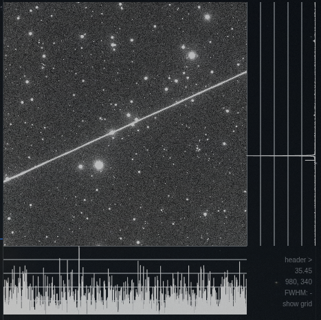
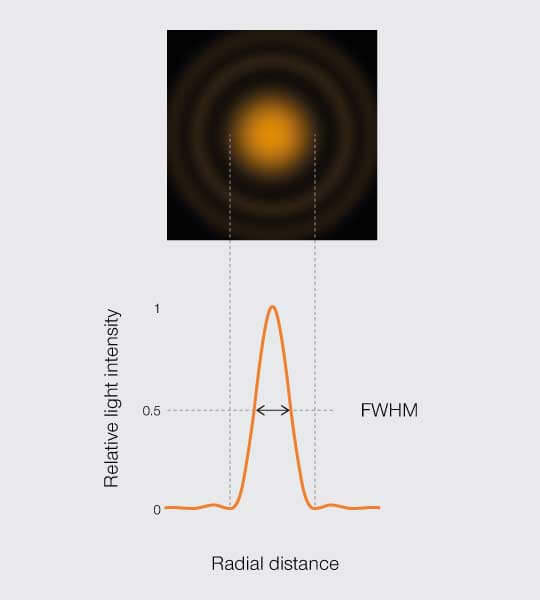
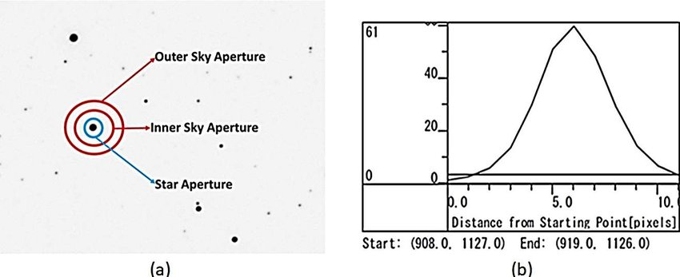

**FITS (Flexible Image Transport System) is the standard data format in astronomy, maintained by the International Astronomical Union (IAU) since 1981 under the guiding principle: "Once FITS, always FITS" (ensuring complete backward compatibility across decades).**

Unlike commercial image formats like PNG or JPEG, which compress pixel values into 8-bit or 16-bit display channels, a FITS file is a scientific container. 

It stores *raw, uncompressed physical detector measurements (floating-point counts, electron charges, or binary tables) coupled with an exhaustive, human-readable audit trail* of how, when, and where the observation occurred.

## Anatomy of a FITS File

At the byte level, a FITS file is organized into sequential units called HDUs (Header-Data Units). Every FITS file consists of at least a Primary HDU, optionally followed by one or more Extension HDUs (Multi-Extension FITS, or MEF).

```
+-------------------------------------------------------------+
|                        PRIMARY HDU                          |
|  +-------------------------------------------------------+  |
|  | Header: ASCII card images (multiples of 2880 bytes)   |  |
|  +-------------------------------------------------------+  |
|  | Primary Data Array: Raw N-D pixel matrix (or empty)   |  |
|  +-------------------------------------------------------+  |
+-------------------------------------------------------------+
|                     EXTENSION HDU 1                         |
|  +-------------------------------------------------------+  |
|  | Extension Header (2880-byte blocks)                   |  |
|  +-------------------------------------------------------+  |
|  | Extension Data: Image, Binary Table, or ASCII Table   |  |
|  +-------------------------------------------------------+  |
+-------------------------------------------------------------+
```

**1. The 2880-Byte Record Block Rule**

A fundamental design law of FITS is that all headers and data blocks must be integer multiples of 2,880 bytes. This is a legacy of magnetic tape blocks (specifically 36 records of 80 bytes each: $36 \times 80 = 2880$).
* If a header ends before a 2,880-byte boundary, it is padded with ASCII spaces (0x20).
* If a data array ends before a 2,880-byte boundary, it is padded with zeros (0x00).

**2. The Header: 80-Character "Card Images"**

A header is composed of 80-byte ASCII character lines ("cards"). Each card follows a strict key-value-comment grammar:

```PlaintextKEYWORD =  VALUE / Comment explaining the parameter```

Every Primary Header must begin with mandatory structural keywords in a fixed order:
* SIMPLE: Boolean (T for True), confirming conformance to the FITS standard.* BITPIX: Data type of the array values:
    * 8: 8-bit unsigned integer
    * 16: 16-bit signed integer
    * 32: 32-bit signed integer
    * -32: 32-bit single-precision IEEE floating-point
    * -64: 64-bit double-precision IEEE floating-point
    
* NAXIS: Dimensionality ($0$ for header-only, $1$ for 1D spectra, $2$ for 2D CCD frames, $3$ for data cubes).
* NAXIS1, NAXIS2: Dimensions along each axis (e.g., $4096 \times 4096$ pixels).
* END: Marks the end of the header card list, after which padding continues to the 2,880-byte boundary.

Beyond the structural keywords, observatories record observational metadata:
* Temporal: DATE-OBS (UTC timestamp), 
* EXPTIME (integration time in seconds).
* Instrumental: TELESCOP, INSTRUME, FILTER (e.g., Johnson $V$, Sloan $r$), GAIN, RDNOISE.
* Astrometric (WCS): World Coordinate System cards (CRVAL1, CRPIX1, CDELT1, CTYPE1, CD1_1, etc.) mathematically mapping $(x, y)$ pixel coordinates to Right Ascension ($\alpha$) and Declination ($\delta$) on the celestial sphere.

**3. The Data Unit**

Following the padded header, the raw data begins.
* Endianness: FITS data is strictly Big-Endian (most significant byte first).
* Units: Pixels are typically measured in ADUs (Analog-to-Digital Units) or electrons ($e^-$), representing direct sensor charge counts, not RGB values.


## How Researchers Bridge FITS Data to Physical Phenomena

Astronomers do not simply "look" at an astronomical image—they measure numbers. Every scientific discovery connects directly to the header keywords and pixel matrices:

**1. Photometry & Calibration**

A raw CCD pixel contains signal plus instrument noise. To recover true photon counts, images must undergo reduction:

$$\text{Calibrated Frame} = \frac{\text{Raw} - \text{Master Bias} - \text{Master Dark}}{\text{Normalized Master Flat}}$$

Once calibrated, aperture photometry integrates the counts within a circular radius around a star, subtracts the background sky annulus, and applies the instrument zero-point ($ZPT$) to find the apparent magnitude:$$m = -2.5 \log_{10}(\text{Flux}) + ZPT$$

**2. Astrometry & Stellar Positions** 

By cross-matching centroid coordinates $(x, y)$ of stars in the pixel matrix with the WCS matrix defined in the header, pixels are transformed into $(\alpha, \delta)$ coordinates. Tracking these over years reveals proper motion ($\mu_\alpha, \mu_\delta$) and trigonometric parallax ($\varpi$).

**3. Stellar Color & Temperature** 

By taking successive FITS frames through different optical filters (e.g., $B$ and $V$), researchers measure the color index $(B - V)$. Hot stars emit predominantly short-wavelength photons (lower $B - V$), while cool stars peak at longer wavelengths (higher $B - V$). This populates the Color-Magnitude Diagram (CMD).

**4. Radial Velocities & Stellar Content (Spectroscopy)** 

When the FITS data is 1D or 2D spectroscopy, pixel columns correspond to calibrated wavelengths ($\lambda$). Absorption line shifts give the line-of-sight velocity via the Doppler formula:$$\frac{\Delta \lambda}{\lambda_0} = \frac{v_r}{c}$$The depth and equivalent width ($W_\lambda$) of lines (e.g., Fe I, Fe II, H$\alpha$) reveal effective temperature ($T_{\text{eff}}$), surface gravity ($\log g$), and metallicity ($[\text{Fe}/\text{H}]$).

**5. Asteroseismology** 

By taking continuous, high-cadence FITS images of a stellar field across hours or nights, researchers extract the star's flux at each time step ($t$). The resulting time-series (stored in FITS binary tables) is fed into a Fourier transform or Lomb-Scargle periodogram. The detected oscillation frequencies ($p$-modes and $g$-modes) probe the density profile, core rotation, and internal composition of the star.



**1. What the Plots and Spikes Represent**

* **Why Point Sources (Stars) Form Sharp Peaks**

   A star is effectively a point source located at infinity. When its light enters the telescope, the optics and Earth's atmosphere spread that incoming bundle of light over multiple pixels according to a bell-shaped distribution called the Point Spread Function (PSF).

   When our crosshair intersects a star, the 1D slice plots the intensity profile of that PSF: a steep rise from the baseline, a peak at the centroid, and a symmetric drop back down. (We can also see a very strong spike on the right vertical plot corresponding to the bright diagonal satellite streak running across your field).

* **Why "Blank Space" is Full of Spikes (The Noise Floor)** 
   
   In observational astronomy, there is no such thing as empty or flat zero-count space. When a CCD looks at "blank sky," it registers a continuous sea of fluctuations—often called "grass"—originating from physical and electronic noise sources:

    * Sky Background (Photon Shot Noise): Even on a dark mountain, the sky glows due to upper atmospheric airglow, scattered zodiacal light, and faint unresolved background galaxies. Arriving photons follow Poisson statistics: if the mean sky background is $N$ photons, the inherent physical uncertainty in every pixel is $\sigma = \sqrt{N}$.
    
    * Readout Noise ($R$): The on-chip output amplifier and analog-to-digital converter introduce electronic Gaussian noise each time a pixel is measured, even with zero light.
    
    * Thermal Noise (Dark Current): Silicon atoms randomly eject thermal electrons during the exposure, adding further Poisson noise ($D \cdot t_{\text{exp}}$).Because each adjacent pixel fluctuates independently around the mean sky background value, a 1D slice through "empty sky" appears as a jagged, high-frequency baseline rather than a flat line.

**2. What is FWHM (Full Width at Half Maximum)?**

   FWHM is the primary scientific metric used to quantify the spatial resolution of an astronomical image and the quality of the atmospheric conditions ("seeing").Plaintext               Peak Intensity (I_max)



The Concept: If we fit a Gaussian curve to a star's brightness profile:$$I(r) = A \cdot \exp\left(-\frac{r^2}{2\sigma^2}\right) + I_{\text{sky}}$$The FWHM is the physical diameter across the star profile at exactly 50% of the peak flux above the background:$$\text{FWHM} = 2\sqrt{2\ln 2}\,\sigma \approx 2.355\,\sigma$$


**Why It Matters?**

   Seeing Measurement: 
   
   * Even if a telescope has ideal optics, atmospheric turbulence smears a star into an apparent disk. When observatory reports "1.2 arcsecond seeing," they mean stars will have a typical FWHM corresponding to 1.2 arcseconds on the detector.
   
   * Separating Real Stars from Artifacts: 

      * A true star's FWHM is governed by seeing and optics (typically spanning 2 to 5+ pixels depending on plate scale).
      * A cosmic ray hit deposits charge directly into single pixels without passing through the atmosphere or optics, resulting in an unnaturally sharp FWHM ($< 1$ pixel).
      * A distant galaxy is spatially resolved and will exhibit an extended FWHM much broader than the local stellar PSF.


**3. What is an Annulus?**

In aperture photometry, calculating a star's brightness requires measuring the photons emitted solely by the star. However, every pixel underlying the star also captured background sky light.

An annulus is a concentric, donut-shaped ring placed around the star to sample and subtract that local background.



How It Works in Practice

* Source Aperture (Inner Circle, radius $r_{\text{aper}}$): Typically set to $\approx 1 \times \text{FWHM}$ to $1.5 \times \text{FWHM}$. It captures the vast majority of the stellar photons, but also contains the sky background directly beneath the star.
* Sky Annulus (Donut between $r_{\text{in}}$ and $r_{\text{out}}$): Placed far enough from the center so that stellar flux has dropped to zero. It samples the pristine local sky and detector noise.
* Subtraction: The software computes the robust median or mode of the pixels within the annulus to establish the background value per pixel ($\text{Sky}_{\text{pixel}}$). The net flux ($F_{\text{star}}$) is then calculated as:$$F_{\text{star}} = \sum_{i \in \text{aperture}} I_i - \left(N_{\text{aper}} \times \text{Sky}_{\text{pixel}}\right)$$where $N_{\text{aper}}$ is the total number of pixels enclosed within the inner aperture.

**4. Why Different Scalings Are Essential**

Standard computer monitors display images using 8-bit brightness levels (256 discrete values, from 0 to 255). A scientific CCD, however, typically has a 16-bit dynamic range (0 to 65,535 ADU) or 32-bit floating-point precision.

**The Dynamic Range Dilemma**

In a typical raw observation:

* The sky background might sit at 500 ADU (with noise fluctuating between 470 and 530 ADU).
* A faint star might have a peak of 580 ADU (only 80 ADU above the background).
* A bright reference star or satellite streak might hit 50,000 ADU or complete saturation (65,535 ADU).

If we apply a standard linear scale from absolute minimum ($0$) to absolute maximum ($65,535$):
* The entire range containing both the sky (500) and the faint star (580) occupies less than 1% of the display spectrum.
* Both the sky and faint star are mapped to pure black. The screen looks completely empty except for a tiny white dot where the brightest star sits.

**How Different Scalings Solve This**

Astronomers use two mathematical tools in tandem to reveal faint details:

**1. Contrast Limits (Cut Levels / ZScale)**

Instead of scaling from absolute min to max, you discard the extremes:
* Black Level ($v_{\text{min}}$): Set just below the sky noise floor (e.g., $\text{Median}(\text{Sky}) - 3\sigma$).
* White Level ($v_{\text{max}}$): Set a few standard deviations above the sky (e.g., $\text{Median}(\text{Sky}) + 10\sigma$).
* The popular ZScale algorithm (built into DS9 and Astropy) automates this by calculating the variance of the sky background to choose $v_{\text{min}}$ and $v_{\text{max}}$ dynamically, ensuring the background noise is visible as soft gray and faint point sources immediately stand out.

**2. Non-Linear Transfer Functions**

When we need to inspect faint nebular features and bright stellar cores simultaneously:
* Logarithmic Scaling ($y = \log(x)$): Severely compresses bright peaks while expanding low count values. Faint stars become distinct while preventing bright stars from blooming into enormous white blobs.

* Asinh Scaling ($y = \text{asinh}(x)$): Developed specifically for astronomical surveys (Lupton et al., 2004). At low signal-to-noise ratios near the sky background, $\text{asinh}(x)$ behaves linearly (preserving background noise properties without exaggerating graininess). As counts increase, it smoothly transitions to a logarithmic response, preserving dynamic detail across many orders of magnitude.